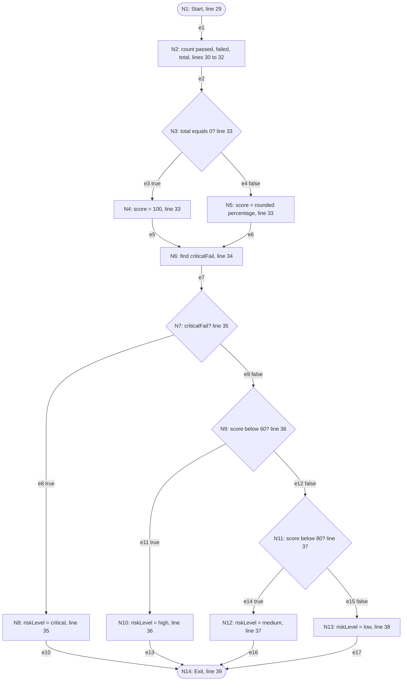
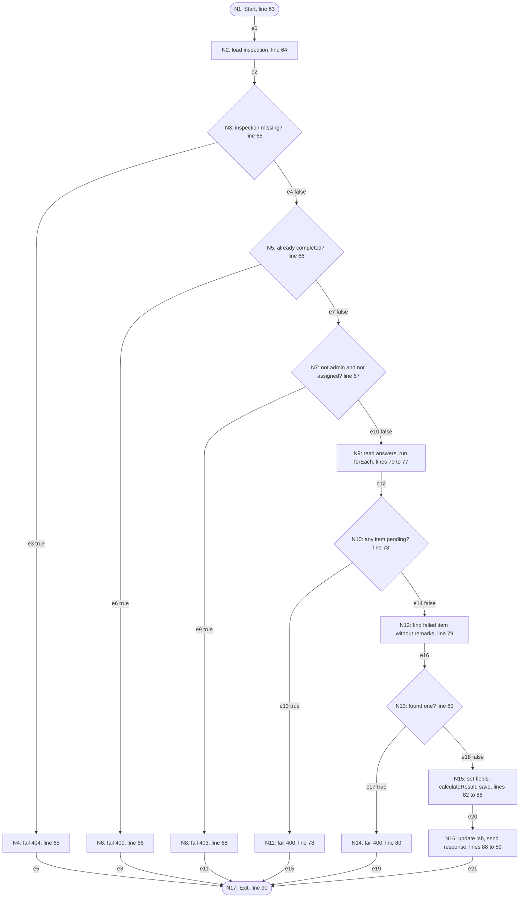
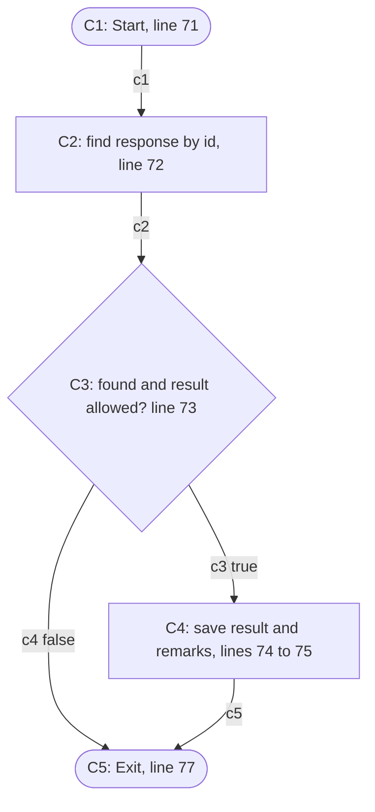

# Task 3.4 (a): Cyclomatic Complexity

Functions measured:

| Function | File | Lines |
|---|---|---|
| `calculateResult()` | `backend/models/Inspection.js` | 29 to 39 |
| `submitInspection()` | `backend/controllers/inspectionController.js` | 63 to 90 |

Note: the module brief gives the file name `inspectionController.js`. In this code base `calculateResult()` is
a method of the Mongoose model, so it is in `backend/models/Inspection.js`. `submitInspection()` is in
`inspectionController.js` and calls `calculateResult()` on line 85.

All values below were counted from the source code and the graphs. No complexity tool was run for this
document.

## 1. Counting rule

Formula: **V(G) = E - N + 2**, where E = number of edges and N = number of nodes in one connected graph with
one entry and one exit.

1. Each function has **one start node and one exit node**.
2. Each `if` and each ternary (`? :`) is **one decision node** with two edges out (true and false).
3. Statements that always run together are joined into one node.
4. `fail()` always throws an error (lines 11 to 14 of the controller). So after a `fail()` node the only edge
   goes to the **exit** node.
5. Functions written inside `filter`, `some`, `find` and `forEach` are **separate functions** with their own
   V(G). In the main graph, the call is a normal statement. The loop inside the array method is not counted.
6. In the **basic** value, `&&` and OR (`||`) are part of one condition and add nothing.
7. Unexpected errors (for example, the database is down or a bad id makes `findById` fail) are not drawn.
8. We check each value in three ways: E - N + 2, number of decisions + 1, and number of regions.

The **extended** value, which also counts `&&` and `||`, is given in section 4.

---

## 2. `calculateResult()`

### 2.1 Source

```js
29  inspectionSchema.methods.calculateResult = function () {
30    const passed = this.responses.filter((r) => r.result === 'pass').length;
31    const failed = this.responses.filter((r) => r.result === 'fail').length;
32    const total = passed + failed;
33    this.score = total === 0 ? 100 : Math.round((passed / total) * 100);
34    const criticalFail = this.responses.some((r) => r.result === 'fail' && r.critical);
35    if (criticalFail) this.riskLevel = 'critical';
36    else if (this.score < 60) this.riskLevel = 'high';
37    else if (this.score < 80) this.riskLevel = 'medium';
38    else this.riskLevel = 'low';
39  };
```

### 2.2 Nodes

| Node | Lines | Content | Decision? |
|---|---|---|---|
| N1 | 29 | Start | |
| N2 | 30-32 | Count passed, failed and total | |
| N3 | 33 | total equals 0? | Yes |
| N4 | 33 | score = 100 | |
| N5 | 33 | score = rounded percentage | |
| N6 | 34 | criticalFail = some(...) | |
| N7 | 35 | criticalFail? | Yes |
| N8 | 35 | riskLevel = critical | |
| N9 | 36 | score below 60? | Yes |
| N10 | 36 | riskLevel = high | |
| N11 | 37 | score below 80? | Yes |
| N12 | 37 | riskLevel = medium | |
| N13 | 38 | riskLevel = low | |
| N14 | 39 | Exit | |

### 2.3 Control-flow graph



### 2.4 Value

| Method | Working | V(G) |
|---|---|---|
| E - N + 2 | E = 17, N = 14, so 17 - 14 + 2 | **5** |
| Decisions + 1 | N3, N7, N9, N11 = 4, so 4 + 1 | **5** |
| Regions | 4 closed regions + 1 outside region | **5** |

Regions:
1. N3-N4-N6 and N3-N5-N6
2. N7-N8-N14 and N7-N9-N10-N14
3. N9-N10-N14 and N9-N11-N12-N14
4. N11-N12-N14 and N11-N13-N14
5. The outside of the graph

All three methods agree: **V(G) = 5**.

### 2.5 Inline functions

Each one is Start, one statement, Exit, so E = 2, N = 3 and V(G) = 2 - 3 + 2 = 1.

| Inline function | Line | E | N | V(G) |
|---|---|---|---|---|
| `filter` for pass | 30 | 2 | 3 | 1 |
| `filter` for fail | 31 | 2 | 3 | 1 |
| `some` for critical fail | 34 | 2 | 3 | 1 |

### 2.6 Basis paths (5)

CR-P5 is the base path. Every other path has edges that are in no other path, so the paths are independent.

| Path | Nodes | Meaning | Edges only in this path |
|---|---|---|---|
| CR-P1 | 1-2-3-4-6-7-9-11-13-14 | total = 0, score 100, low | e3, e5 |
| CR-P2 | 1-2-3-5-6-7-8-14 | critical item failed, critical | e8, e10 |
| CR-P3 | 1-2-3-5-6-7-9-10-14 | score below 60, high | e11, e13 |
| CR-P4 | 1-2-3-5-6-7-9-11-12-14 | score 60 to 79, medium | e14, e16 |
| CR-P5 | 1-2-3-5-6-7-9-11-13-14 | score 80 or more, low | Base path |

The graph has 2 x 4 = 8 possible routes. Three cannot happen: after N4 the score is 100 and nothing failed,
so N8, N10 and N12 cannot be reached. The other 5 are exactly the basis paths, so **5 tests cover every path
that can happen**.

---

## 3. `submitInspection()`

### 3.1 Source

```js
63  exports.submitInspection = asyncHandler(async (req, res) => {
64    const insp = await Inspection.findById(req.params.id);
65    if (!insp) fail(res, 404, 'Inspection not found');
66    if (insp.status === 'completed') fail(res, 400, 'Inspection already completed');
67    if (req.user.role !== 'admin' && String(insp.inspector) !== String(req.user._id))
68      fail(res, 403, 'Only the assigned inspector can submit this inspection');
69
70    const answers = req.body.responses || [];
71    answers.forEach((a) => {
72      const r = insp.responses.id(a._id);
73      if (r && ['pass', 'fail', 'na'].includes(a.result)) {
74        r.result = a.result;
75        r.remarks = a.remarks || '';
76      }
77    });
78    if (insp.responses.some((r) => r.result === 'pending')) fail(res, 400, 'Answer every checklist item before submitting');
79    const missingRemark = insp.responses.find((r) => r.result === 'fail' && !r.remarks);
80    if (missingRemark) fail(res, 400, `Remarks are required for failed item: "${missingRemark.text}"`);
81
82    insp.summary = req.body.summary;
83    insp.status = 'completed';
84    insp.completedDate = new Date();
85    insp.calculateResult();
86    await insp.save();
87
88    await Lab.findByIdAndUpdate(insp.lab, { lastInspectionDate: insp.completedDate, lastScore: insp.score });
89    res.json(await populate(Inspection.findById(insp._id)));
90  });
```

### 3.2 Nodes

| Node | Lines | Content | Decision? |
|---|---|---|---|
| N1 | 63 | Start | |
| N2 | 64 | Load the inspection | |
| N3 | 65 | Inspection missing? | Yes |
| N4 | 65 | fail 404 | |
| N5 | 66 | Already completed? | Yes |
| N6 | 66 | fail 400 | |
| N7 | 67 | Not admin and not assigned? | Yes |
| N8 | 68 | fail 403 | |
| N9 | 70-77 | Read answers and run forEach | |
| N10 | 78 | Any item still pending? | Yes |
| N11 | 78 | fail 400 | |
| N12 | 79 | Find a failed item without remarks | |
| N13 | 80 | Found one? | Yes |
| N14 | 80 | fail 400 | |
| N15 | 82-86 | Set fields, calculateResult, save | |
| N16 | 88-89 | Update the lab, send the response | |
| N17 | 90 | Exit | |

### 3.3 Control-flow graph



### 3.4 Value

| Method | Working | V(G) |
|---|---|---|
| E - N + 2 | E = 21, N = 17, so 21 - 17 + 2 | **6** |
| Decisions + 1 | N3, N5, N7, N10, N13 = 5, so 5 + 1 | **6** |
| Regions | 5 closed regions + 1 outside region | **6** |

Regions:
1. N3-N4-N17 and N3-N5-N6-N17
2. N5-N6-N17 and N5-N7-N8-N17
3. N7-N8-N17 and N7-N9-N10-N11-N17
4. N10-N11-N17 and N10-N12-N13-N14-N17
5. N13-N14-N17 and N13-N15-N16-N17
6. The outside of the graph

All three methods agree: **V(G) = 6**.

### 3.5 Inline functions

The `forEach` function has its own decision, so it has its own graph.



| Inline function | Line | E | N | V(G) | Check |
|---|---|---|---|---|---|
| `forEach` | 71-77 | 5 | 5 | 5 - 5 + 2 = **2** | 1 decision + 1 = 2; 1 closed region + 1 outside = 2 |
| `some` for pending | 78 | 2 | 3 | 2 - 3 + 2 = **1** | 0 decisions + 1 = 1 |
| `find` for missing remark | 79 | 2 | 3 | 2 - 3 + 2 = **1** | 0 decisions + 1 = 1 |

The helpers `fail()` (lines 11 to 14) and `populate()` (lines 8 to 9) have no decisions, so V(G) = 1 each.

### 3.6 Basis paths (6)

| Path | Nodes | Meaning |
|---|---|---|
| SI-P1 | 1-2-3-4-17 | Inspection not found, 404 |
| SI-P2 | 1-2-3-5-6-17 | Already completed, 400 |
| SI-P3 | 1-2-3-5-7-8-17 | Not the assigned inspector, 403 |
| SI-P4 | 1-2-3-5-7-9-10-11-17 | An item is still pending, 400 |
| SI-P5 | 1-2-3-5-7-9-10-12-13-14-17 | Failed item without remarks, 400 |
| SI-P6 | 1-2-3-5-7-9-10-12-13-15-16-17 | Success, 200 |

Each of SI-P1 to SI-P5 goes through its own `fail()` node, so the 6 paths are independent. They are also the
only routes in the graph.

Paths of the `forEach` function: **FE-P1** C1-C2-C3-C4-C5 (answer is saved) and **FE-P2** C1-C2-C3-C5 (answer
is ignored).

---

## 4. Extended value (also counts `&&` and `||`)

Rule: **extended value = 1 + every `if` and ternary + every `&&` and `||`**, where the code of the inline
functions is now counted as part of the main function. `||` used for a default value (lines 70 and 75) is
counted too, because it also has two outcomes. The loops inside the array methods are still not counted.

| | `calculateResult()` | `submitInspection()` |
|---|---|---|
| Start value | 1 | 1 |
| `if` and ternary in the main function | 4 (lines 33, 35, 36, 37) | 5 (lines 65, 66, 67, 78, 80) |
| `if` in the `forEach` function | 0 | 1 (line 73) |
| `&&` | 1 (line 34) | 3 (lines 67, 73, 79) |
| `\|\|` | 0 | 2 (lines 70, 75) |
| **Extended value** | **6** | **12** |

If each function is kept separate but `&&` and `||` are counted:

| Function | Working | Value |
|---|---|---|
| `calculateResult()` main | 1 + 4 | 5 |
| its `some` function (line 34) | 1 + 1 | 2 |
| `submitInspection()` main | 1 + 5 + 2 (lines 67, 70) | 8 |
| its `forEach` function | 1 + 1 + 2 (lines 73, 75) | 4 |
| its `find` function (line 79) | 1 + 1 | 2 |
| its `some` function (line 78) | 1 | 1 |

Check: 5 + (2 - 1) = 6, and 8 + (4 - 1) + (2 - 1) + (1 - 1) = 12. These match the extended values.

---

## 5. Result

| Function | E | N | Basic V(G) | Extended value |
|---|---|---|---|---|
| `calculateResult()` | 17 | 14 | **5** | 6 |
| `submitInspection()` | 21 | 17 | **6** | 12 |
| `forEach` function in `submitInspection()` | 5 | 5 | **2** | 4 (already included in the 12) |

- A common guideline (McCabe) is to keep V(G) at 10 or below. Both basic values are below 10.
- `submitInspection()` is 12 when everything is joined. The extra complexity is in the compound conditions
  (lines 67, 73, 79) and the default values (lines 70, 75), so these need their own tests.
- Basis path testing needs at least 5 tests for `calculateResult()`, 6 for `submitInspection()` and 2 for the
  `forEach` function. See `coverage-test-design.md`.
