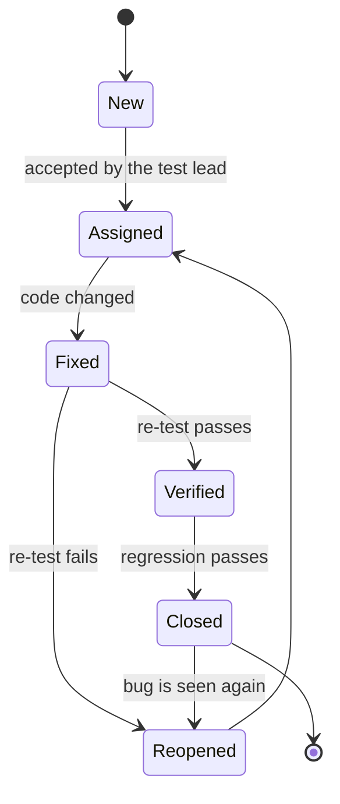

# Bug life cycle: BUG-004

> **SIMULATED LIFE CYCLE.** Only the state **New** is real (25 Nov 2026). The states Assigned, Fixed, Verified and Closed are
> simulated for the report, because the application source in the repository must not be changed.
> **In the repository BUG-004 is still open (status New).** Its two tests still fail there.

Bug: [BUG-004](BUG-004-admin-self-protection-bypass.md), an admin can demote or delete the own account by sending the id in capital letters.

## 1. State diagram

## 2. Life cycle table

| State | Date | Owner | Action | Evidence |
|---|---|---|---|---|
| New | 25 Nov 2026 (**real**) | [Reporter] | TC-USR-03.6 failed in the first run. The delete variation was added and also failed. Bug reported: Moderate, Medium | `qa/evidence/phase2-jest-all-first-run.log` lines 324-329, `qa/evidence/phase2-known-defects.log` lines 223-246, `qa/evidence/phase2-rerun-known-defects.log` lines 222-245 |
| Assigned | 25 Nov 2026 (simulated) | [Test Lead] | Report checked (steps, evidence, not a duplicate), severity and priority confirmed, given to [Developer] | None, simulated step |
| Fixed | 25 Nov 2026 (simulated) | [Developer] | Change both self checks (`userController.js:24` and `:37`) in a throwaway copy outside the repository. The repository is not changed. Change tried: `req.params.id.toLowerCase()` in both checks | **Real run in the copy:** `qa/evidence/phase3-bug004-fix-in-copy.log` section 2 (the changed lines). The state, owner and date are simulated |
| Verified | 25 Nov 2026 (simulated) | [Tester] | Re-test in the throwaway copy: TC-USR-03.6 and TC-USR-04.5 variation must pass. TC-USR-03.5, TC-USR-04.5 and the rest of the main suite must still pass | **Real run in the copy:** same log. Before the change both tests failed (section 1). After it both passed (section 3), and the main suite gave 335 passed, 0 failed (section 4). The copy was then deleted |
| Closed | 25 Nov 2026 (simulated) | [Test Lead] | Would be closed after the fix is merged and the two tests are moved from `known-defects/` to `api/users.test.js` | None, simulated step. Not done in the repository |

**Reopened** was not used. It would be used if the re-test fails, or if the bug is seen again after closing (then back to Assigned).

## 3. Rules for each change of state

| From > to | Who | Condition |
|---|---|---|
| New > Assigned | [Test Lead] | The bug is reproduced, has evidence, and is not a duplicate |
| Assigned > Fixed | [Developer] | Code changed, cause noted (see `rca-5-whys.md`) |
| Fixed > Verified | [Tester], not the person who fixed it | Both failing tests pass |
| Fixed > Reopened | [Tester] | A failing test still fails |
| Verified > Closed | [Test Lead] | Main suite passes (no regression), tests moved to the main suite |
| Closed > Reopened | Anyone | The same bug is seen again |

## 4. Real state today

| Item | Value |
|---|---|
| State of BUG-004 in the repository | **New** (open) |
| Code in the repository | `backend/controllers/userController.js` not changed |
| GitHub issue | NOT EXECUTED (text is ready in `github-issues/BUG-004.md`) |
