# Testing the Smart Laboratory Safety Inspection Platform

**Project report**

| | |
|---|---|
| Module | EC4206 Software Testing and Quality Assurance |
| Project | Group project, Option A: testing an existing project |
| System under test | Smart Laboratory Safety Inspection Platform |
| University / department | ______________________________ |
| Lecturer | ______________________________ |
| Submission date | 25 November 2026 |
| Code repository | github.com/Anuththara-SZ/lab-safety-platform-QA |

| Group member | Registration number | Tasks |
|---|---|---|
| ____________________ | ____________ | ____________________ |
| ____________________ | ____________ | ____________________ |
| ____________________ | ____________ | ____________________ |
| ____________________ | ____________ | ____________________ |

**Notation.** NOT EXECUTED means the step was not run and no result exists. Names such as `phase3-jmeter-run1-summary.log` are files in the folder `qa/evidence/`. Screenshots are the original files and are not edited.

<!-- pagebreak -->

## AI-use disclosure

An AI assistant (Claude, used through Claude Code) helped with this project. It helped to:

- set up the test tools,
- draft the test documents, bug reports, root cause analyses, reflection and this report,
- generate the test code, the CI workflow and the JMeter plan,
- run the test commands on a group member's laptop and save the logs in `qa/evidence`.

The application source code was not changed.

The saved logs come from runs that were started with the help of the AI assistant on a group member's laptop. The GitHub Actions runs (section 6.5) and the SonarCloud analysis (section 9.3) were started from the group's own GitHub and SonarCloud accounts.

**Contribution of each member:**

| Member | Decided, ran, checked or corrected |
|---|---|
| ____________________ | ______________________________________________ |
| ____________________ | ______________________________________________ |
| ____________________ | ______________________________________________ |
| ____________________ | ______________________________________________ |

<!-- pagebreak -->

## Table of contents

<!-- toc -->
1. [Introduction](#1-introduction)
2. [Test plan (3.1)](#2-test-plan-31)
3. [STLC and test cases (3.2)](#3-stlc-and-test-cases-32)
4. [Black-box test design (3.3)](#4-black-box-test-design-33)
5. [White-box test design (3.4)](#5-white-box-test-design-34)
6. [Automation and CI/CD (3.5 and 3.6)](#6-automation-and-cicd-35-and-36)
7. [Performance and security (3.7)](#7-performance-and-security-37)
8. [Defect management (3.8)](#8-defect-management-38)
9. [Quality metrics (3.9)](#9-quality-metrics-39)
10. [Agile and DevOps reflection (3.10)](#10-agile-and-devops-reflection-310)
11. [Limitations](#11-limitations)
12. [Conclusion and lessons learned](#12-conclusion-and-lessons-learned)
13. [Appendix: evidence index](#13-appendix-evidence-index)
<!-- /toc -->

<!-- pagebreak -->

## 1. Introduction

### 1.1 System under test

The Smart Laboratory Safety Inspection Platform is a web application. Administrators register laboratories and checklists, inspectors carry out scored inspections, and users report incidents. A dashboard shows totals and trends.

| Part | Technology | Size (non-blank lines) | Source |
|---|---|---|---|
| Backend REST API | Node.js, Express, Mongoose, MongoDB | 817 | `phase0-baseline.log` |
| Frontend | React, Vite | 2,017 JS/JSX and 80 CSS | `phase0-baseline.log` |

There are three roles (admin, inspector, technician) and 29 API routes (counted by hand, `qa/01-test-plan/test-plan.md`). The original project had no test files and no `test` script (`phase0-baseline.log`).

### 1.2 Why this project

We used Option A, reuse of an existing project: we test a finished application and do not change it.

Facts that make it suitable for testing:

- It has three roles and a permission matrix, so access control can be tested.
- It has a scoring rule with clear limits (60 and 80), which suits boundary and white-box testing.
- It has an API and a user interface, so several test levels are possible.
- It had no tests, so a before and after comparison is possible.

### 1.3 Objectives and scope

**Objectives**

1. Check that the platform does what its README promises.
2. Check the score and risk level, because a wrong result can make an unsafe lab look safe.
3. Check that each role can do only what the permission matrix allows.
4. Check that bad input gives a clear 4xx error and not a server error (500).
5. Measure coverage, response time and code quality.
6. Report each defect with steps, expected result, actual result and evidence.

| In scope | Out of scope |
|---|---|
| All 29 API routes as admin, inspector, technician and unauthenticated user | Changing or fixing the application |
| Scoring, risk, validation, error codes, linked records on delete | Systems other than our local copy |
| Login, login error and hidden admin controls in the UI | Mobile devices and browsers other than Chrome |
| Local load test and checks of two OWASP Top 10 items | Printed report layout and chart appearance |
| Coverage, duplication, `npm audit`, SonarCloud | Production hosting and long-run tests |

**Rule for expected results:** they come from the README. Where the README is silent, the test says "reasonable expectation". All such tests are listed in section 11.

## 2. Test plan (3.1)

Full document: `qa/01-test-plan/test-plan.md`.

### 2.1 Test levels

| Level | What | Technique | Tool |
|---|---|---|---|
| Unit | `calculateResult()` | White-box, branch coverage | Jest |
| Integration / API | Routes, middleware, database | Equivalence classes, boundary values, decision tables | Jest, Supertest, mongodb-memory-server |
| System (UI) | 3 cases | Scenario based | selenium-webdriver, headless Chrome |
| Acceptance (BDD) | 2 Gherkin scenarios | Scenario based | Cucumber.js |
| Performance | Login and lab list | Load test | JMeter |
| Security | Access control, authentication | OWASP checks | curl |
| Static | Duplication, dependencies, code smells | Tool scan | jscpd, `npm audit`, SonarCloud |

### 2.2 Resources

| Role | Responsibility | Person |
|---|---|---|
| Test lead | Plan, schedule, final check | ____________ |
| Test designer | Test cases, black-box, white-box | ____________ |
| Automation tester | Jest, Supertest, Cucumber, Selenium, CI | ____________ |
| Performance / security tester, defect manager | JMeter, OWASP, defects, metrics | ____________ |

Hardware: one Windows 11 laptop. Client, server and database ran on the same machine. Tool versions are in section 3.2.

### 2.3 Schedule (planned order)

All phases were planned for 25 November 2026, before 23:00. The plan fixes only the order.

| Order | Phase | Work |
|---|---|---|
| 1 | Setup and baseline | Install, run, baseline metrics |
| 2 | Test design | Tasks 3.1 to 3.4 |
| 3 | Automation | Tasks 3.5 and 3.6 |
| 4 | Performance, security, defects | Tasks 3.7 and 3.8 |
| 5 | Metrics and reflection | Tasks 3.9 and 3.10 |
| 6 | Submission | Check links and evidence |

### 2.4 Main risks

| Risk | Chance | Impact | Mitigation |
|---|---|---|---|
| `npm run seed` wipes the database | High | High | Separate database `lab_safety_qa` or an in-memory database |
| Rate limits block tests (50 on `/api/auth`, 1000 on `/api`, per 15 minutes and address) | High | High | Reuse tokens, restart the server between groups, count 429 separately |
| Frontend install fails (ERESOLVE) | Happened | Medium | `npm ci --legacy-peer-deps`, reported as BUG-001 |
| MongoDB download for the in-memory server fails | Happened (no log saved) | Medium | Use the installed `mongod` as a separate temporary process |
| Docker and the Sonar scanner are not installed | Happened | Medium | SonarCloud through GitHub Actions |
| README does not cover some cases | High | Medium | Mark as "reasonable expectation" |
| Load test on one laptop | High | Medium | Report as local results only |
| Only one day left | High | High | Test the highest risk first |

### 2.5 ISO 25010 attributes

| Attribute | How measured | Our target | Result |
|---|---|---|---|
| Functional suitability | Functional test cases, boundary values, decision tables | 100% executed, every failure reported | 45 of 45 executed, 32 pass, 13 fail (`phase5-fill-results.log`) |
| Security | Permission matrix, 2 OWASP checks, stack trace check | No wrong cell, or a defect is logged | 153 of 155 matrix requests as designed, the other 2 are BUG-003 (`phase2-defect-observations.md`) |
| Reliability | 500 answers for bad input, orphan records, errors under load | No 500 for client mistakes | Target not met: BUG-005 and O-08. No orphan records were found for labs and users |
| Usability | 3 Selenium UI cases | All 3 executed | 3 passed (`phase2-rerun-ui.log`). No user survey was done |
| Performance efficiency | JMeter | Targets proposed by the AI assistant, to be confirmed by the group. The README has none | See section 7 |

### 2.6 Verification and validation

| | Verification | Validation |
|---|---|---|
| Question | Are we building the product right? | Are we building the right product? |
| Compared with | README, design, code rules | Real needs of lab staff |
| Example 1 | Compare the README permission matrix with `authorize(...)` in the routes | Log in as a technician and check that admin controls are hidden (TC-PERM-02) |
| Example 2 | V(G) and branch tests for `calculateResult()` | Cucumber scenario: a failed critical item gives "critical" risk |
| Example 3 | Read the code: all N/A sets the score to 100 | Ask if a lab where nothing was checked should show 100 and "low" (TC-INS-05) |

## 3. STLC and test cases (3.2)

Full documents: `stlc-mapping.md`, `test-environment.md` and `test-cases.md` in `qa/02-stlc-test-cases`.

### 3.1 STLC phases

| STLC phase | In this project | Deliverable | State |
|---|---|---|---|
| 1. Requirement analysis | Read the README and the code, list requirements R1 to R15 and unclear points G1 to G11 | `stlc-mapping.md` | Written |
| 2. Test planning | Scope, levels, tools, risks, ISO 25010 | `qa/01-test-plan` | Written |
| 3. Test case design | 45 test cases, 42 EP, 40 BVA, 2 decision tables, 28 white-box cases | `qa/02`, `qa/03`, `qa/04` | Written |
| 4. Environment setup | Install, seed data, baseline | `test-environment.md` | Done, logs saved |
| 5. Test execution | Automated tests, UI, load, security, defect reports | `qa/05` to `qa/08` | Run locally and on GitHub Actions (section 6.5) |
| 6. Closure | Coverage, defect density, lessons | `qa/09`, `qa/10` | Written. SonarCloud analysis done (section 9.3) |

### 3.2 Test environment

| Item | Version | Source |
|---|---|---|
| Operating system | Windows 11 Home Single Language 10.0.26200 | `phase0-versions.log` |
| Node.js / npm | v24.14.0 / 11.9.0 | `phase0-versions.log` |
| Browser | Chrome 157.0.8103.80 (headless) | `phase0-versions.log` |
| MongoDB | 8.3.4 | `phase0-versions.log` |
| Java / JMeter | Temurin 21.0.12.1 / 5.6.3 | `phase0-versions.log` |
| Jest, Supertest | 30.5.2, 7.3.2 | `phase0-versions.log` |
| mongodb-memory-server | 11.4.0 | `phase0-versions.log` |
| Cucumber, selenium-webdriver | 13.3.0, 4.51.0 | `phase0-versions.log` |

Automated tests use a temporary in-memory MongoDB with the demo data of `backend/seed.js`. Security and load tests used a separate database `lab_safety_qa`, which was removed afterwards (`phase3-task37-cleanup.log`).

| Role | Demo account |
|---|---|
| admin | admin@lab.com |
| inspector | inspector@lab.com |
| technician | tech@lab.com |

### 3.3 Test case results

Each case has ID, description, preconditions, steps, expected result, actual result and status. A case fails if at least one of its checks fails.

| Group | Area | Cases | Pass | Fail | Failing cases |
|---|---|---|---|---|---|
| AUTH | Login, registration | 8 | 6 | 2 | TC-AUTH-04, 07 |
| LAB | Laboratories | 7 | 5 | 2 | TC-LAB-04, 07 |
| TPL | Checklist templates | 5 | 4 | 1 | TC-TPL-04 |
| INS | Inspections | 9 | 3 | 6 | TC-INS-02, 03, 05, 07, 08, 09 |
| INC | Incidents | 5 | 4 | 1 | TC-INC-05 |
| USR | Users | 5 | 4 | 1 | TC-USR-03 |
| PERM | Permissions | 6 | 6 | 0 | - |
| **Total** | | **45** | **32** | **13** | |

Source: `phase5-fill-results.log` (TC: 32 Pass, 13 Fail). Group counts: `test-cases.md`. The API cases were run as automated tests and not typed by hand.

**Reasons for the 13 failing cases**

| Case | What happened | Recorded as |
|---|---|---|
| TC-AUTH-04 | Password sent as a number gives 500 | BUG-005 |
| TC-AUTH-07 | Malformed JSON gives 500 | O-08 |
| TC-LAB-04 | `?search[]=x` gives 500 | BUG-005 |
| TC-LAB-07 | Error body has `stack` when NODE_ENV is not set | O-11 |
| TC-TPL-04 | Template used by a scheduled inspection can be deleted | O-12 |
| TC-INS-02 | Impossible date is saved as another day | BUG-006 |
| TC-INS-03 | Past date is accepted | O-07 |
| TC-INS-05 | All N/A gives score 100 and risk low | BUG-002 |
| TC-INS-07 | Unknown response id is ignored | O-05 |
| TC-INS-08 | Wrong type in `responses` gives 500 | BUG-005 |
| TC-INS-09 | Inspector reads the inspection of another inspector | BUG-003 |
| TC-INC-05 | Editing a resolved incident changes the resolved date | O-13 |
| TC-USR-03 | Admin changes the own role with the id in capital letters | BUG-004 |

**Permission matrix:** 29 routes for 4 roles are in section 10 of `test-cases.md`. TC-PERM-01 to 06 all pass. TC-PERM-02 is a UI case.

## 4. Black-box test design (3.3)

Full documents: `qa/03-black-box`. Counts: `phase5-fill-results.log`.

| Technique | Cases | Pass | Fail | Recorded |
|---|---|---|---|---|
| Equivalence partitioning | 42 | 33 | 2 | 7 |
| Boundary value analysis | 40 | 31 | 7 | 2 |
| Decision table DT1, role x action | 29 | 27 | 2 | 0 |
| Decision table DT2, risk level | 8 | 6 | 0 | 2 |

"Recorded" means the README does not define the case and the test only records what the code does today.

### 4.1 Equivalence partitioning

| Input | Valid | Invalid | Not specified | Total |
|---|---|---|---|---|
| Email (register) | 2 | 6 | 1 | 9 |
| Password (register) | 1 | 3 | 3 | 7 |
| Lab capacity | 3 | 6 | 1 | 10 |
| Checklist result (pass, fail, na, others) | 3 | 11 | 2 | 16 |
| **Total** | **9** | **26** | **7** | **42** |

**Worked example 1, checklist result (EP-27 to EP-40).** The input is the `result` value of an item in `PUT /api/inspections/:id/submit`.

| ID | Class | Value | Expected | Actual | Status |
|---|---|---|---|---|---|
| EP-27 | Valid | `"pass"` | 200, score 100, low | As expected | Pass |
| EP-30 | Invalid | `"fail"` without remarks | 400 | As expected | Pass |
| EP-33 | Invalid | `"maybe"` | 400 | As expected | Pass |
| EP-39 | Invalid | `"responses": "pass"`, not a list | 400 | 500 "answers.forEach is not a function" | Fail (BUG-005) |
| EP-40 | Invalid | `"responses": [null]` | 400 | 500 "Cannot read properties of null (reading '_id')" | Fail (BUG-005) |

One value per class was enough to find that the type of the whole list is not checked.

### 4.2 Boundary value analysis

Boundaries: score 0, 59/60, 79/80, 100 and all N/A; rounding; password length 5/6/7; capacity 0/1/2; dates.

**Worked example 2, score limits.** All items are non-critical.

| ID | Pass / fail | Expected | Actual | Status |
|---|---|---|---|---|
| BVA-03 | 59 / 41 | 59, high | As expected | Pass |
| BVA-04 | 3 / 2 | 60, medium | As expected | Pass |
| BVA-06 | 79 / 21 | 79, medium | As expected | Pass |
| BVA-07 | 4 / 1 | 80, low | As expected | Pass |
| BVA-15 | 119 / 81 (59.5) | high | medium | Fail (O-02) |
| BVA-17 | 159 / 41 (79.5) | medium | low | Fail (O-02) |

The whole-number limits work. The code rounds before it compares, so 59.5 and 79.5 move to a safer band. The README says nothing about rounding, so this is an observation and not a bug report.

**Dates**

| ID | Date | Expected | Actual | Status |
|---|---|---|---|---|
| BVA-32 | `not-a-date` | 400 | As expected | Pass |
| BVA-38 | `2028-02-29` (leap day) | 201 | As expected | Pass |
| BVA-36 | `2027-02-29` (does not exist) | 400 | 201, saved as 2027-03-01 | Fail (BUG-006) |
| BVA-39 | `2028-02-30` (does not exist) | 400 | 201, saved as 2028-03-01 | Fail (BUG-006) |

BVA-29 (yesterday) expects 400 and fails, because the API saves the date with 201 (O-07). 400 is a reasonable expectation: the README and the code have no rule about past dates.

### 4.3 Decision tables

**Worked example 3, DT2 risk level.** Conditions: C1 total = 0, C2 critical item failed, C3 score below 60, C4 score below 80. Four conditions give 16 combinations: 7 possible and 9 impossible.

| | R1 | R2 | R3 | R4 | R5 | R6 | R7 |
|---|---|---|---|---|---|---|---|
| C1: total = 0 | Y | N | N | N | N | N | N |
| C2: critical item failed | N | Y | Y | Y | N | N | N |
| C3: score below 60 | N | Y | N | N | Y | N | N |
| C4: score below 80 | N | Y | Y | N | Y | Y | N |
| **Risk level** | low (suspect) | critical | critical | critical | high | medium | low |

R1 is the all-N/A case. The README formula gives 0 / 0. The suspicion became BUG-002.

**DT1 role x action (extract).** Insp-N is an inspector who is not assigned to the inspection.

| ID | Action | Admin | Assigned inspector | Insp-N | Technician | No token | Status |
|---|---|---|---|---|---|---|---|
| DT1-07 | Create lab | 201 | 403 | 403 | 403 | 401 | Pass |
| DT1-15 | Open a scheduled inspection | 200 | 200 | 403 | 403 | 401 | Fail: Insp-N got 200 (BUG-003) |
| DT1-16 | Open a completed inspection | 200 | 200 | 403 | 200 | 401 | Fail: Insp-N got 200 (BUG-003) |
| DT1-19 | Submit an inspection | 200 | 200 | 403 | 403 | 401 | Pass |
| DT1-23 | Update incident | 200 | 200 | 200 | 403 | 401 | Pass |
| DT1-28 | Change role | 200 | 403 | 403 | 403 | 401 | Pass |

## 5. White-box test design (3.4)

Full documents: `qa/04-white-box`. Note: the task names `inspectionController.js`, but `calculateResult()` is in `backend/models/Inspection.js` (lines 29 to 39). `submitInspection()` is in `backend/controllers/inspectionController.js` (lines 63 to 90).

### 5.1 Cyclomatic complexity

Formula: V(G) = E - N + 2. Each `if` and ternary is one decision. Functions inside `filter`, `some`, `find` and `forEach` are counted separately. The values were counted by hand; no complexity tool was run.

| Function | E | N | E - N + 2 | Decisions + 1 | Regions | V(G) | Extended value |
|---|---|---|---|---|---|---|---|
| `calculateResult()` | 17 | 14 | 17 - 14 + 2 | 4 + 1 | 4 + 1 | **5** | 6 |
| `submitInspection()` | 21 | 17 | 21 - 17 + 2 | 5 + 1 | 5 + 1 | **6** | 12 |
| `forEach` function in `submitInspection()` | 5 | 5 | 5 - 5 + 2 | 1 + 1 | 1 + 1 | **2** | 4, included in the 12 |

The extended value also counts `&&` and `||`.

### 5.2 Control-flow graphs

**Figure 1. Control-flow graph of `calculateResult()`**

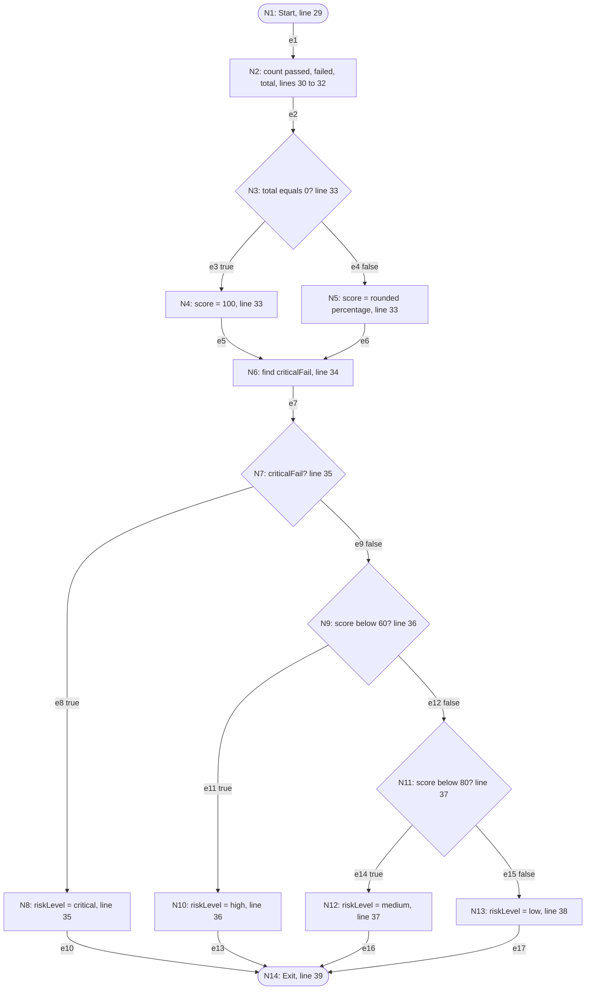

**Figure 2. Control-flow graph of `submitInspection()`**

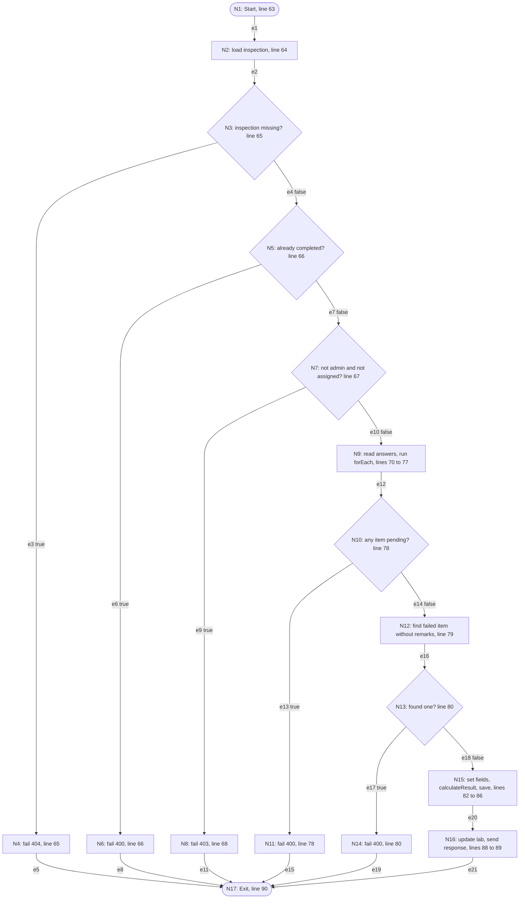

**Figure 3. Control-flow graph of the `forEach` function in `submitInspection()`**

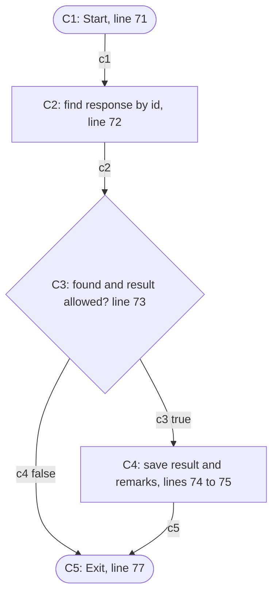

### 5.3 Basis paths and tests

| Path | Meaning | Test | Result |
|---|---|---|---|
| CR-P1 | Total = 0, score 100, low | WB-CR-01 | Recorded (README silent) |
| CR-P2 | Critical item failed | WB-CR-02 | Pass |
| CR-P3 | Score below 60, high | WB-CR-03 | Pass |
| CR-P4 | Score 60 to 79, medium | WB-CR-04 | Pass |
| CR-P5 | Score 80 or more, low | WB-CR-05 | Pass |
| SI-P1 | Inspection not found, 404 | WB-SI-01 | Pass |
| SI-P2 | Already completed, 400 | WB-SI-02 | Pass |
| SI-P3 | Not the assigned inspector, 403 | WB-SI-03 | Pass |
| SI-P4 | Item still pending, 400 | WB-SI-04 | Pass |
| SI-P5 | Failed item without remarks, 400 | WB-SI-05 | Pass |
| SI-P6 | Success, 200 | WB-SI-06 | Pass |
| FE-P1, FE-P2 | Answer saved / answer ignored | WB-SI-04, WB-SI-08 | Pass |

### 5.4 Statement and branch coverage

There are 28 white-box cases: 12 for `calculateResult()` (10 Pass, 2 Recorded) and 16 for `submitInspection()` (14 Pass, 1 Fail, 1 Recorded) (`phase5-fill-results.log`). WB-SI-13 fails because `responses` is not checked (BUG-005).

| Function | Smallest set for all statements | Added for all `if` branches | Jest file |
|---|---|---|---|
| `calculateResult()` | WB-CR-02 to 05 | WB-CR-01 | `qa/05-tdd-bdd/unit/calculateResult.test.js` |
| `submitInspection()` | WB-SI-01 to 06 | WB-SI-08 | `qa/06-automation-cicd/api/inspections.test.js` |

| Function | Lines covered | Branches covered | Source |
|---|---|---|---|
| `calculateResult()` | 10/10 | 10/10 | `phase4-function-coverage.log` |
| `submitInspection()` | 22/22 | 22/22 | `phase4-function-coverage.log` |

LCOV counts executed lines, so line coverage is shown. The branch numbers are the same as our hand count (10 and 22).

## 6. Automation and CI/CD (3.5 and 3.6)

### 6.1 Results

| Suite | Tool | Passed | Failed | Source |
|---|---|---|---|---|
| Main suite: 28 unit and 307 API checks | Jest, Supertest | 335 | 0 | `phase4-coverage.log`, `phase2-rerun-main.log`; split: `qa/06-automation-cicd/README.md` |
| Known defects | Jest, Supertest | 0 | 29 | `phase2-rerun-known-defects.log` |
| BDD: 2 scenarios, 16 steps | Cucumber.js | 2 | 0 | `phase2-rerun-bdd.log` |
| UI: 3 cases | selenium-webdriver | 3 | 0 | `phase2-rerun-ui.log` |

**Why the main suite has no failures.** The first run of all unit and API tests gave 335 passed and 28 failed (`phase2-jest-all-first-run.log`). These 28 checks were moved to a separate known-defects suite, and one more was added later. No test is skipped. The 335 also include 11 checks that only record the present behaviour, because the README is silent. Two of these 11 (all N/A and unknown item id) record behaviour that a known-defect check says is wrong.

Figures 4 to 9 are screenshots of these runs on the laptop.

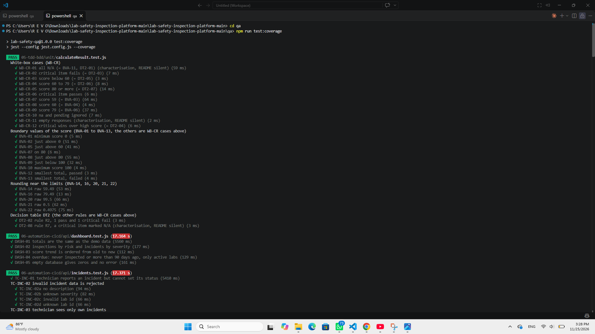

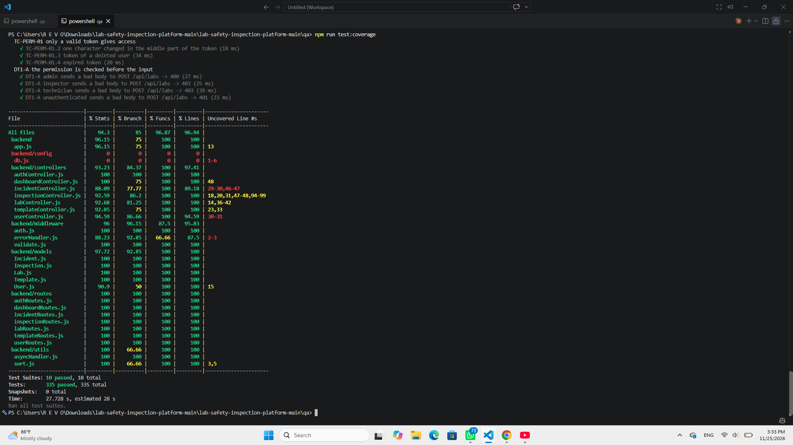

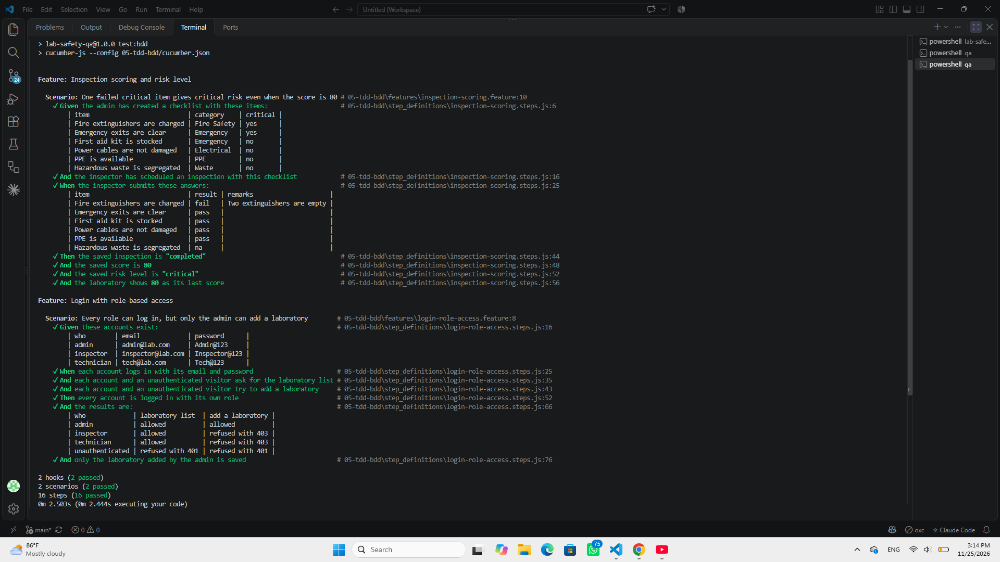

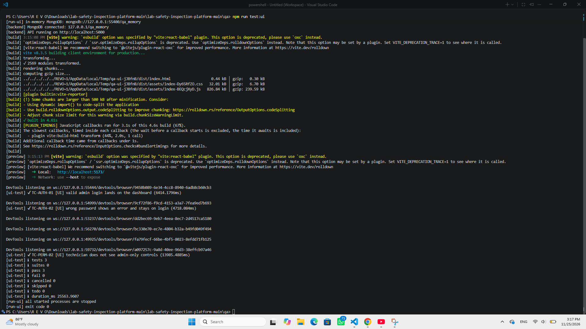

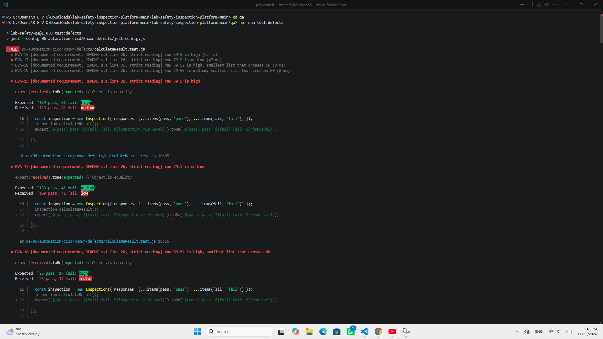

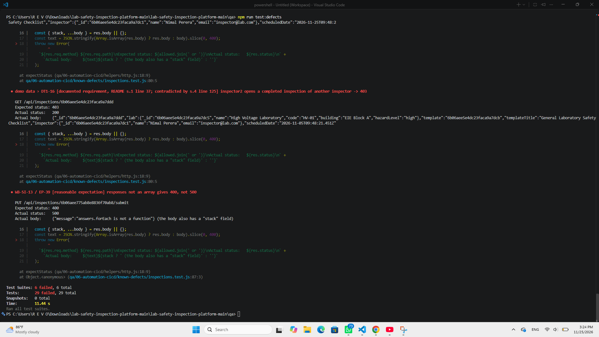

### 6.2 TDD

The application was finished before our project, so our unit tests are test-after and not real TDD. The known-defect checks are the "red" step. For BUG-004 a fix was tried in a throwaway copy outside the repository: 2 tests failed before and passed after, and the main suite stayed at 335 passed (`phase3-bug004-fix-in-copy.log`). For TC-INS-05 the green, check and refactor steps are NOT EXECUTED.

### 6.3 BDD scenarios

| Feature | Scenario | Result |
|---|---|---|
| Login with role-based access | Every role can log in, but only the admin can add a laboratory | Passed |
| Inspection scoring and risk level | One failed critical item gives critical risk even when the score is 80 | Passed |

Shortened extract of the second scenario (`qa/05-tdd-bdd/features/inspection-scoring.feature`):

```gherkin
Scenario: One failed critical item gives critical risk even when the score is 80
  Given the admin has created a checklist with these items: ...
  And the inspector has scheduled an inspection with this checklist
  When the inspector submits these answers: ...
  Then the saved inspection is "completed"
  And the saved score is 80
  And the saved risk level is "critical"
  And the laboratory shows 80 as its last score
```

### 6.4 Supertest and Selenium

| API test file | Tests | API test file | Tests |
|---|---|---|---|
| `auth.test.js` | 26 | `incidents.test.js` | 12 |
| `rateLimit.test.js` | 2 | `users.test.js` | 16 |
| `labs.test.js` | 28 | `permissions.test.js` | 161 |
| `templates.test.js` | 10 | `dashboard.test.js` | 5 |
| `inspections.test.js` | 47 | **Total** | **307** |

| UI case | Check | Result |
|---|---|---|
| TC-AUTH-01 | Valid admin login lands on the dashboard | Passed |
| TC-AUTH-02 | Wrong password shows an error and stays on login | Passed |
| TC-PERM-02 | Technician does not see admin-only controls, admin does | Passed |

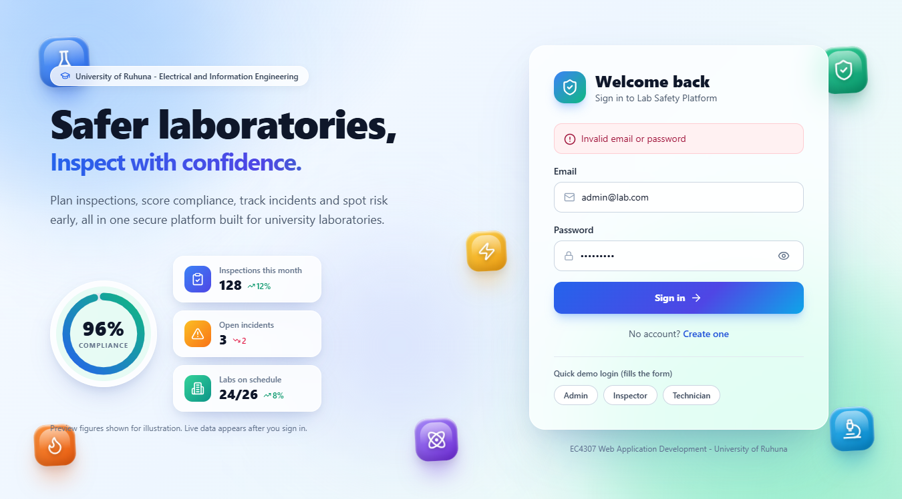

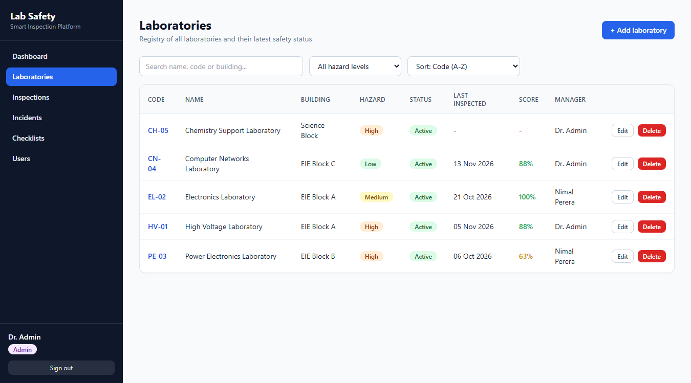

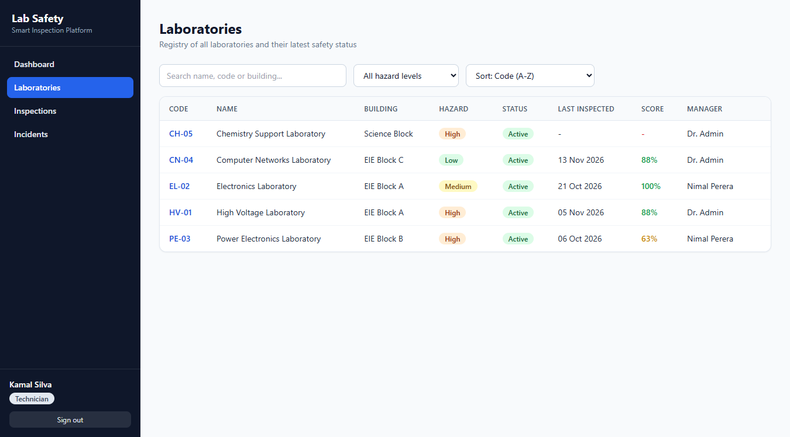

The wrong-password case was also checked by hand in the browser (Figure 14). The page shows the message "Invalid email or password" and stays on the login page, as in TC-AUTH-02.

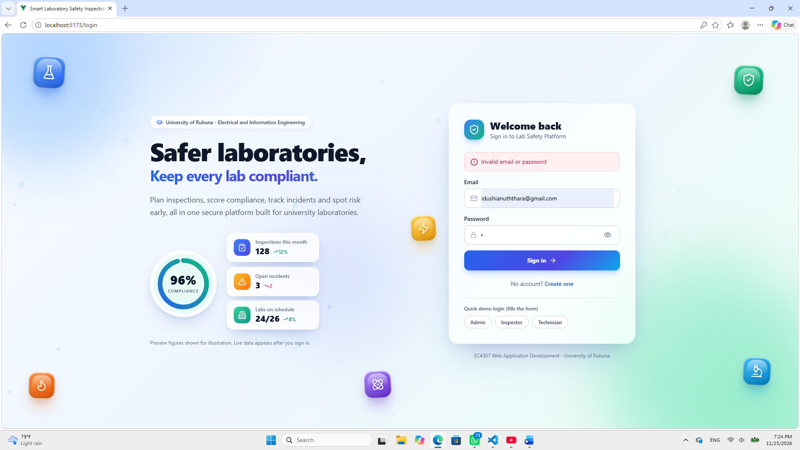

### 6.5 GitHub Actions

File: `.github/workflows/qa.yml`, runs on every push and pull request on `ubuntu-24.04` with Node 24.

| Step | What it does |
|---|---|
| Install backend | `npm ci` |
| Install frontend | `npm ci --legacy-peer-deps`, because of BUG-001 |
| Install QA tools | `npm ci` in `qa` |
| Unit and API tests with coverage | `npm run test:coverage` |
| BDD tests | `npm run test:bdd` |
| UI tests | `npm run test:ui` |
| **Known defects (expected to fail until the app is fixed)** | `npm run test:defects` with `continue-on-error: true` |
| SonarCloud scan | Only when the secret `SONAR_TOKEN` exists |
| Upload coverage and screenshots | Always |

The known-defects step shows its failures but does not block the pipeline. So a red main result means that something new is broken.

**Result on GitHub.** The workflow ran 5 times on the `main` branch of `Anuththara-SZ/lab-safety-platform-QA` (Figure 10). The list shows these runs:

| Run | Commit message | Result | Time |
|---|---|---|---|
| QA #1 | Add QA deliverables for EC4206 STQA project | Passed | 1 min 24 s |
| QA #4 | Add SonarQube Cloud screenshots | **Failed** | 1 min 34 s |
| QA #5 | Fix SonarCloud settings and update scan action to v8.5.1 | Passed | 2 min 51 s |
| QA #6 | Add project report, screenshots and consistency fixes | Passed | 2 min 23 s |
| QA #7 | Fix SonarCloud settings and update scan action to v8.5.1 | Passed | 2 min 29 s |

Run #4 failed. We did not save its log, so the exact reason is not in our evidence. The next run (#5) used a commit that changed the SonarCloud settings and the scan action, and it passed. The list shows 5 runs, and the run numbers #2 and #3 are not in it. The Sonar scan ran on GitHub (section 9.3). The screenshot shows only the run list. It does not show the step output, so the test counts on GitHub were not compared with the local counts.

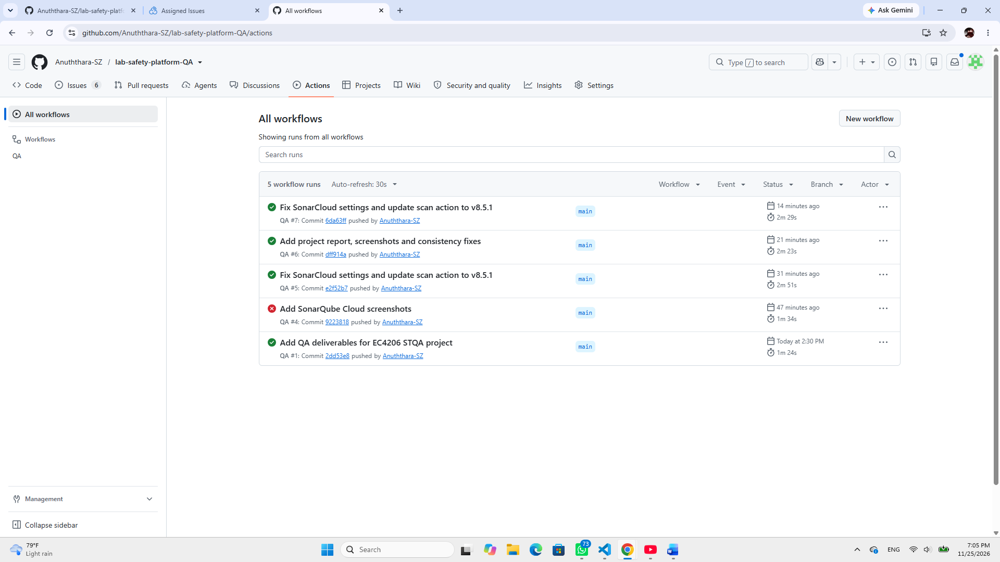

## 7. Performance and security (3.7)

### 7.1 JMeter setup

Plan: `qa/07-performance-security/load-test.jmx`. Each user sends `POST /api/auth/login`, then `GET /api/labs` with the token. JMeter 5.6.3 ran in non-GUI mode. The machine is in `phase3-jmeter-environment.log`.

The application allows 50 requests to `/api/auth` and 1000 to `/api` per 15 minutes and address. The limits were not switched off. The backend was restarted before each run.

| Run | Users | Ramp-up | Loops | Reads per login | Purpose |
|---|---|---|---|---|---|
| run1, run1b, run1c | 50 | 10 s | 1 | 18 | Inside the limits |
| run2 | 50 | 10 s | 10 | 1 | Limiter active |
| run3, run3b (extra) | 50 | 1 s | 1 | 18 | All 50 users at nearly the same time |

### 7.2 JMeter results

Times in ms. Source: `phase3-jmeter-<run>-summary.log`.

| Run | Request | Count | Avg | Median | p95 | Max | Req/s | Error % | Most active users |
|---|---|---|---|---|---|---|---|---|---|
| run1 | Login | 50 | 145.7 | 155 | 200 | 215 | 5.1 | 0.00 | 15 |
| run1 | GET labs | 900 | 67.6 | 34 | 181 | 360 | 93.3 | 0.00 | 15 |
| run1b | Login | 50 | 97.3 | 94 | 116 | 147 | 5.1 | 0.00 | 4 |
| run1b | GET labs | 900 | 5.4 | 4 | 10 | 94 | 92.9 | 0.00 | 4 |
| run1c | Login | 50 | 156.3 | 154 | 205 | 251 | 5.1 | 0.00 | 11 |
| run1c | GET labs | 900 | 73.8 | 40 | 166 | 350 | 91.6 | 0.00 | 11 |
| run3 | Login | 50 | 3280.9 | 3697 | **4230** | 4325 | 11.1 | 0.00 | 50 |
| run3 | GET labs | 900 | 173.5 | 127 | 345 | 3689 | 152.6 | 0.00 | 50 |
| run3b | Login | 50 | 2885.7 | 3186 | **4322** | 4444 | 10.9 | 0.00 | 50 |
| run3b | GET labs | 900 | 210.3 | 126 | 461 | 3944 | 139.2 | 0.00 | 50 |

**run2, limiter active** (1000 requests, errors 900, **90.00 %**, 24 most active users, `phase3-jmeter-run2-summary.log`)

| Request and status | Count | Avg | Median | p95 | Max |
|---|---|---|---|---|---|
| Login, 200 | 50 | 480.6 | 434 | 927 | 1134 |
| Login, 429 | 450 | 10.3 | 5 | 21 | 336 |
| GET labs, 200 | 50 | 600.3 | 538 | 1128 | 1490 |
| GET labs, 401 (no valid token) | 450 | 9.4 | 4 | 21 | 272 |

**What the numbers mean**

| Target (proposed by the AI assistant, to be confirmed by the group; README has none) | Result |
|---|---|
| GET labs p95 below 1000 ms | Met in run1, run1b, run1c, run3, run3b. Not met for the successful reads of run2 (1128, only 50 samples) |
| Login p95 below 2000 ms | Met when users arrive over 10 s. **Not met in run3 and run3b** (4230 and 4322) |
| 0 % errors inside the limits | Met in all 5 runs inside the limits |

- run2 measures the limiter and not the capacity. Exactly 50 logins passed.
- In run1 only 4 to 15 users were active at once, so run3 was added.
- Successful logins ran at about 11 per second in run2, run3 and run3b. A likely reason is password hashing with `bcryptjs` in one process. This was not profiled.
- The same test gave an average of 71.7, 10.2 and 78.1 ms. The reason is unknown, because CPU load was not recorded during the runs.
- One laptop ran everything, so these are not production figures. The real capacity is unknown.

The targets were proposed by the AI assistant, to be confirmed by the group (`phase3-jmeter-environment.log`). The README has no targets.

### 7.3 Security checks

curl against `http://127.0.0.1:5055` only. Requests were started by a script, and the raw responses were saved. Full tables: `qa/07-performance-security/security-checks.md`.

| OWASP item | Requests in the log | As expected | Not as expected |
|---|---|---|---|
| A01:2021 Broken Access Control | 50 (3 are setup) | 45 | 5 |
| A07:2021 Identification and Authentication Failures | 41, plus loops | 36 | 5 |

PASS = as expected. FAIL = breaks the README or a rule the application already has. OBSERVATION = README silent, the owner must decide.

**A01 Broken Access Control** (`phase3-security-a01.log`)

| ID | Request | Expected | Response | Verdict |
|---|---|---|---|---|
| A01-01a | Technician: `POST /api/labs` | 403 | 403 "Role 'technician' is not allowed to perform this action" | PASS |
| A01-01b | Inspector: `POST /api/labs` | 403 | 403 "Role 'inspector' is not allowed to perform this action" | PASS |
| A01-01c | No token: `POST /api/labs` | 401 | 401 "Not authenticated: token missing" | PASS |
| A01-01e | Admin: `POST /api/labs` (control) | 201 | 201 | PASS |
| A01-02b | Second inspector: `GET /api/inspections/<CH05>`, not own, scheduled | 403 | 200 with inspection data | **FAIL (BUG-003)** |
| A01-02c | Second inspector: `GET /api/inspections/<HV01>`, not own, completed | 403 | 200 | **FAIL (BUG-003)** |
| A01-03a | Second inspector: submit the inspection of another | 403 | 403 "Only the assigned inspector can submit this inspection" | PASS |
| A01-04a | Technician: open a scheduled inspection | 403 | 403 "Report not available yet" | PASS |
| A01-05e | Technician: `GET /api/dashboard` | No incidents of others | 200, shows an incident of the inspector | OBSERVATION (O-15) |
| A01-06a | Technician: `PUT /api/incidents/<burn>` | 403 | 403 | PASS |
| A01-07a | Inspector: change own role to admin | 403 | 403 | PASS |
| A01-08a | Register with `"role":"admin"` | Technician | 201, role technician | PASS |
| A01-09b | Admin: change own role, own id in capitals | 400 | 200, role technician | **FAIL (BUG-004)** |
| A01-09d | Admin: delete own account, own id in capitals | 400 | 200 "User deleted" | **FAIL (BUG-004)** |
| A01-11a | Admin: create a lab with `lastScore` 100 | Refused or ignored | 201, stored | OBSERVATION |

**A07 Authentication Failures** (`phase3-security-a07.log`)

| ID | Request | Expected | Response | Verdict |
|---|---|---|---|---|
| A07-01a | Register, password `12345` | 400 | 400 "Password must be at least 6 characters" | PASS |
| A07-01b | Register, password `123456` | Refused | 201 | OBSERVATION |
| A07-01c | Register, password `password` | Refused | 201 | OBSERVATION |
| A07-02a, b | Login, wrong password / unknown email | 401, same message | 401, same message | PASS |
| A07-02d | Login, known email, password as a number | 401 | 500 "Illegal arguments: number, string" | **FAIL (BUG-005)** |
| A07-02e | Login, unknown email, password as a number | 401 | 401, so d and e show which emails exist | see A07-02d |
| A07-03b | Login, password `{"$ne":null}` | 400, no login | 500, no token | OBSERVATION |
| A07-04d | `GET /api/labs`, tampered token | 401 | 401 | PASS |
| A07-04f | `GET /api/users`, `alg=none` token | 401 | 401 | PASS |
| A07-05g, h | Deleted user, old token | 401 | 401 "User no longer exists" | PASS |
| A07-06b | Same token after the logout attempt (no logout route, 404) | - | 200, token lifetime 7 days | OBSERVATION |
| A07-07 | 51 wrong logins | Limit exists | 50 x 401, first 429 at request 51 | PASS |
| A07-07c | Another account, same address, while blocked | - | 429, the limit is per address | OBSERVATION |
| A07-09 | 51 logins with false `X-Forwarded-For` | 429 for 51 | 429 | PASS |
| A07-10 | Token lifetime 2 s | 200, then 401 | 200, then 401 | PASS |

Not run: login timing comparison (NOT EXECUTED), other OWASP items, HTTPS, proxy.

## 8. Defect management (3.8)

Full documents: `qa/08-defects`. All six bugs were reproduced.

### 8.1 Defect summary

| ID | Title | Basis | Severity | Priority | Status | Failing tests |
|---|---|---|---|---|---|---|
| BUG-001 | Frontend dependencies cannot be installed (ERESOLVE) | Documented, README line 92 | Major | High | New | 0 (found by commands) |
| BUG-002 | Inspection with every item N/A is saved as 100 / low | Reasonable expectation | Major | High | New | 2 |
| BUG-003 | Inspector can read the inspection of another inspector | Documented, README contradicts itself | Moderate | Medium | New | 3 |
| BUG-004 | Admin can demote or delete the own account with the id in capitals | Reasonable expectation | Moderate | Medium | New | 2 |
| BUG-005 | Input of the wrong type gives 500 | Reasonable expectation | Minor | Low | New | 6 |
| BUG-006 | A date that does not exist is saved as another day | Reasonable expectation | Minor | Medium | New | 3 |

16 of the 29 failing checks belong to these reports. The other 13 belong to 8 observations.

**Severity rule.** A bug that only breaks a reasonable expectation is Moderate or lower. BUG-002 is the one exception, because it shows an unchecked lab as safe.

| Severity | Meaning |
|---|---|
| Critical | The system cannot be used, data is lost, or a person without rights gets control |
| Major | A main function does not work or gives a wrong result that people may trust |
| Moderate | A rule or access limit does not hold, but only for a special request or role |
| Minor | Bad input is not refused properly, normal use is not affected |

**Observations not raised as separate bugs**

| ID | Observation | Basis | Failing checks |
|---|---|---|---|
| O-02 | Rounding moves a score into a safer band | Documented, strict reading | BVA-15, 17, 18, 19 |
| O-05 | Unknown response id is ignored | Reasonable expectation | TC-INS-07 |
| O-07 | Past date is accepted | Reasonable expectation | TC-INS-03, BVA-29 |
| O-08 | Malformed JSON gives 500 | Reasonable expectation | TC-AUTH-07 |
| O-11 | Stack trace when NODE_ENV is not set | Reasonable expectation | TC-LAB-07b |
| O-12 | Template in use can be deleted | Reasonable expectation | TC-TPL-04.1, 04.2 |
| O-13 | Editing a resolved incident changes the date | Reasonable expectation | TC-INC-05 |
| O-15 | Dashboard shows a technician the incidents of others | Reasonable expectation | DASH-06 |

**Suspects that did not reproduce:** invalid ObjectId (400, not 500) and orphan records after deleting a lab or user (409). Source: `phase2-defect-observations.md` section 2.

### 8.2 5 Whys: BUG-002

Problem: 8 answers "na" gave `status 200, score=100, risk=low` (`phase2-known-defects.log`).

| Why? | Answer | State |
|---|---|---|
| 1. Why is the lab shown as safe? | Score 100 is not below 60 or 80, so risk is "low". The score is copied to the lab | Verified |
| 2. Why was the score 100? | Only pass and fail are counted. With N/A only, the total is 0 and the code uses 100 | Verified |
| 3. Why the fixed value 100? | The formula is 0 / 0 and some value was needed | Likely, not confirmed |
| 4. Why did no other check stop it? | N/A is accepted for every item, also critical ones. There is no "not assessed" level | Verified |
| 5. Why was it missed? | The README does not define the case and there were no automated tests | Verified |

**Root cause:** the requirement does not define the case, and the code fills the gap with an unsafe default. Place: `backend/models/Inspection.js:33`. **Prevention:** write the rule first, use a safe default, keep TC-INS-05 as a regression test.

### 8.3 5 Whys: BUG-004

Problem: an admin sent the own id in capitals. Change role gave 200 and delete gave 200 "User deleted" (`phase2-known-defects.log`).

| Why? | Answer | State |
|---|---|---|
| 1. Why was the own account changed? | The self check was false, so the code went on | Verified |
| 2. Why was the check false? | It compares two texts with `===`, and the letter case is different | Verified |
| 3. Why was the account still found? | The database id does not depend on letter case | Verified |
| 4. Why does the raw text reach the check? | No rule checks or normalises `:id` | Verified |
| 5. Why was it missed? | No automated tests, and the web page never sends this request | Verified |

**Root cause:** ids are compared as text, with unchecked client input on one side. Place: `backend/controllers/userController.js:24` and `:37`. **Prevention:** use `ObjectId.equals()`, one shared check, validate `:id`, keep TC-USR-03.6 as a regression test. Last-admin lockout was not tested.

### 8.4 Bug life cycle: BUG-004

> **SIMULATED LIFE CYCLE.** Only the state New is real. The later states are simulated, because the application in the repository must not be changed. In the repository BUG-004 is still open.

| State | Date | Owner | Action | Evidence |
|---|---|---|---|---|
| New | 25 Nov 2026 (real) | Reporter: ________ | TC-USR-03.6 failed, bug reported | `phase2-jest-all-first-run.log`, `phase2-known-defects.log` |
| Assigned | 25 Nov 2026 (simulated) | Test lead: ________ | Report checked and given to the developer | None, simulated |
| Fixed | 25 Nov 2026 (simulated) | Developer: ________ | Change tried in a throwaway copy, repository not changed | Real run: `phase3-bug004-fix-in-copy.log` |
| Verified | 25 Nov 2026 (simulated) | Tester: ________ | Both tests failed before and passed after; main suite 335 passed | Real run: same log |
| Closed | 25 Nov 2026 (simulated) | Test lead: ________ | Would be closed after the fix is merged | None, simulated |

**GitHub Issues.** The six reports were created as issues in `Anuththara-SZ/lab-safety-platform-QA` from the texts in `qa/08-defects/github-issues`. The list shows 6 open issues, 0 closed, each with the label `bug` (Figure 15). They match the table in section 8.1. The other observations were not raised as issues.

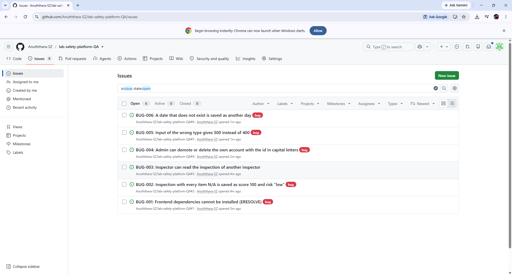

## 9. Quality metrics (3.9)

Full documents: `baseline-metrics.md` and `quality-report.md` in `qa/09-quality-metrics`.

### 9.1 Coverage

| Metric (backend, main suite) | Before | After | Source |
|---|---|---|---|
| Statements | Nothing tested | 94.3% (447/474) | `phase4-function-coverage.log` |
| Branches | Nothing tested | 85% (153/180) | `phase4-function-coverage.log` |
| Functions | Nothing tested | 96.87% (62/64) | `phase4-function-coverage.log` |
| Lines | Nothing tested | 96.94% (413/426) | `phase4-function-coverage.log` |

`seed.js` and `server.js` are not included. The frontend has no unit tests, so it has no coverage value. The lowest branch values are `config/db.js` 0, `User.js` 50 and `sort.js` 66.66 (`phase4-coverage.log`).

Coverage does not prove correctness: `calculateResult()` has 10/10 branches covered and still contains BUG-002.

### 9.2 Size and defect density

KLOC counts code lines without blank lines and comments, for the backend without `seed.js` (697) and the frontend JS/JSX (1992): 2689 lines = **2.689 KLOC** (`phase4-loc.log`).

Defect density = defects / KLOC (`phase4-defect-density.log`):

| Count | Calculation | Result |
|---|---|---|
| **Reported defects (BUG-001 to 006)** | 6 / 2.689 | **2.23 per KLOC** |
| Without BUG-001 (configuration file, not in the counted lines) | 5 / 2.689 | 1.86 per KLOC |
| Backend only (BUG-002 to 006) | 5 / 0.697 | 7.17 per KLOC |
| All observed issues (15 test issues and BUG-001) | 16 / 2.689 | 5.95 per KLOC |

The backend was tested much more than the frontend, so the frontend may have defects that we did not find.

### 9.3 SonarQube / SonarCloud

Docker and the scanner were not found on the machine (`phase1-sonar-availability.log`), so the scan ran through GitHub Actions on SonarCloud (project `Anuththara-SZ_lab-safety-platform-QA`, branch `main`, settings in `qa/09-quality-metrics/sonar-project.properties`). It scans `backend` and `frontend/src`. The Jest coverage file is `qa/coverage/lcov.info`. The values below are read from two screenshots (Figures 16 and 17). They are not in a log file.

| Metric (SonarCloud) | First analysis, no coverage (Figure 16) | Later analysis, with coverage (Figure 17) |
|---|---|---|
| Quality gate (Sonar way) | Not computed | **Failed** |
| Lines of code | 5.3k | 5.5k |
| Security, open issues (rating) | 19 (E) | 20 (E) |
| Reliability, open issues (rating) | 55 (D) | 68 (D) |
| Maintainability, open issues (rating) | 41 (A) | 41 (A) |
| Security hotspots | 0 | 100% reviewed |
| Dependency risks (rating) | 23 (C) | 23 (C) |
| Coverage | Not set up | **28.2%** |
| Duplications | 0.4% | 0.4% |
| Technical debt | Not shown | Not shown |

The first analysis was of commit `2dd53e8`. Figure 17 shows the analysis of 25 November 2026, 17:50.

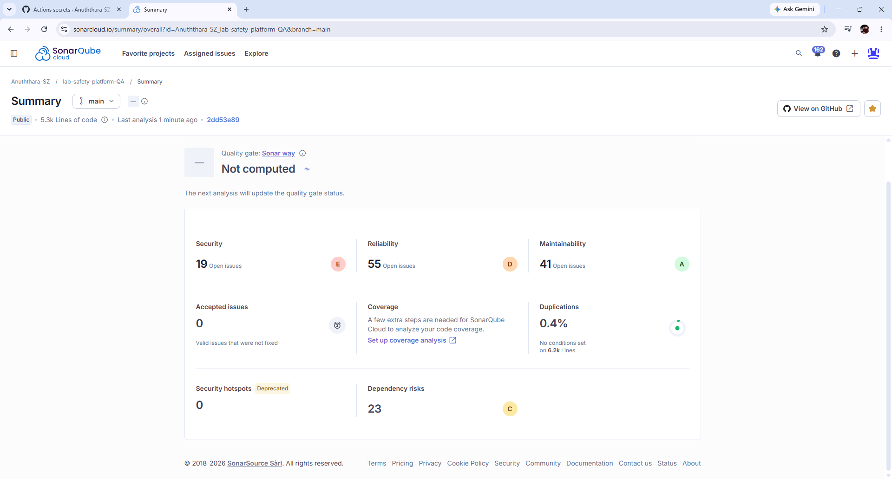

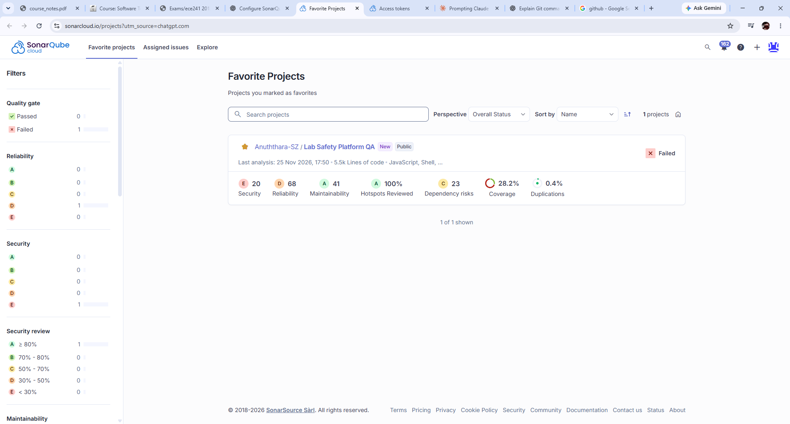

**What we can and cannot say**

- Coverage was only measured after the coverage file was added. Sonar shows 28.2%, our Jest report shows 94.3% statements (section 9.1). The two numbers may use different scopes and we did not investigate the difference. We rely on the Jest figure for the backend, because it comes from a saved log.
- The quality gate failed. The screenshots do not show which condition failed, so we do not state the reason.
- The number of issues is higher in the later analysis (security 19 to 20, reliability 55 to 68). We did not compare the two analyses, so the reason is unknown.
- We did not open the individual issues. We do not know how many are real defects, so none of them was added to the defect list (section 8).
- Sonar duplication (0.4%) and jscpd (about 4.9%) differ. We did not check why, but the tools count in different ways.

| Measured without Sonar | Value | Source |
|---|---|---|
| Duplicated lines (jscpd, another method, per format) | javascript 4.92%, jsx 4.86% | `phase1-jscpd.log` |
| npm audit, backend | 1 high severity vulnerability reported (mongoose), exploitability not tested | `phase0-npm-audit-backend.log` |
| npm audit, frontend | 1 high severity vulnerability reported (follow-redirects), exploitability not tested | `phase1-npm-audit-frontend.log` |

### 9.4 Three improvements

| # | Improvement | Evidence | Check |
|---|---|---|---|
| 1 | Validate types and dates on every route and use the parser's status code in `errorHandler.js` | BUG-005, BUG-006, O-08 | Their known-defect checks pass |
| 2 | Write the missing rules in the README and fix the code: nothing assessed, who may read an inspection, id comparison | BUG-002, BUG-003, BUG-004 | TC-INS-05, TC-INS-09, TC-USR-03 pass |
| 3 | Fix the Vite conflict, review the `npm audit` findings, keep CI on every push | BUG-001 | `npm ci` works without `--legacy-peer-deps` |

**What the metrics tell us.** The backend is covered well by tests (94.3% statements, 85% branches) and the 335 main checks pass, but 6 defects and 8 observations were still found, so the system is not defect-free. The defect density is 2.23 per KLOC for all code and 7.17 per KLOC for the backend, which was tested much more than the frontend. SonarCloud reports many open issues and a failed quality gate, so the code has maintainability and reliability work to do, even though we did not review those issues one by one.

**Which number is most important.** The 100% branch coverage of `calculateResult()` together with BUG-002 is the number that taught us most: a function can be fully covered and still give an unsafe answer when nothing was checked. A second surprise is the gap between Sonar coverage (28.2%) and Jest coverage (94.3%).

**Which improvement first.** Improvement 2 (write the missing rules and fix BUG-002), because an unchecked lab that is shown as safe is the only defect that can mislead a person about safety. Improvements 1 and 3 are cheaper and can follow.

## 10. Agile and DevOps reflection (3.10)

This is a short version of `qa/10-reflection/reflection.md`.

**Shift-left.** The application was finished, so testing during development was not possible. Reading the README and the code first still found unclear rules before any test ran: who may read an inspection, and the score when every item is N/A. Both became bugs. BUG-001 was found during installation.

**Continuous integration.** The original project had no tests and no pipeline. The workflow runs unit, API, BDD and UI tests on every push. Known defects run in a separate step that may fail. The risk is that people stop looking at a step that always fails, so each of its checks has a defect report or an observation.

**TDD and BDD.** The unit tests are test-after. The 29 known-defect checks are red tests that describe the expected behaviour. For BUG-004 two tests went from red to green in a throwaway copy. The BDD scenarios took their expected results from the README and not from the code.

**Defect feedback loop.** Each failure went from test to log, observation and bug report. Every report says if it breaks a documented requirement or only a reasonable expectation. Two of the five first suspects did not reproduce, and this is reported. The loop is not complete, because the application could not be changed.

**What we did in a DevOps way.** We pushed our work to GitHub in several commits on one day, and each push started the QA workflow. Of the 5 runs in Figure 10, 4 passed and 1 failed (run #4). The failed run was followed by a commit that fixed the SonarCloud settings, and the next run passed. This is a small example of the feedback loop: push, see the result, fix, push again.

**What was hard.** The application could not be changed, so a defect stayed open after it was found. Several expected results had to be our own judgement because the README is silent (section 11.2). The one-day time limit meant that the frontend got only 3 UI cases.

**What we would do differently.** Start CI and SonarCloud earlier, so that the first failed run (#4) would have appeared sooner. Save the log of every failed run. Agree the performance targets with the group before the load test. Add frontend unit tests.

## 11. Limitations

### 11.1 NOT EXECUTED or not tested

| Item | State |
|---|---|
| GitHub Actions logs and step counts | Only the run list was captured (Figure 10). Log of failed run #4 not saved |
| SonarCloud: technical debt, reason for the failed gate, review of single issues, reason for 28.2% coverage | Not shown by the screenshots, not investigated |
| GitHub Issues for the 8 observations | Not created, only the 6 bug reports |
| Login timing for known and unknown email | NOT EXECUTED, steps in `security-checks.md` section 6 |
| TDD green, check and refactor steps for TC-INS-05 | NOT EXECUTED, proposed only |
| Life cycle states Assigned to Closed of BUG-004 | Simulated |
| Last admin lockout and delete with linked records for BUG-004 | Not tested |
| BUG-003 in the browser | Not tested, API only |
| Database state after the failing status checks of BUG-004 and BUG-005 | Not shown by the Jest logs, tests stop at the status |
| Manual typing of the 45 test cases | Not done, run as automated tests |
| PowerShell examples in `test-cases.md` and `test-environment.md`, and the commands in section 6 of `boundary-value-analysis.md` | No saved run |
| Expected scores of the seed data in `test-environment.md` section 5 | Worked out by hand there |
| Frontend unit tests | None exist |
| Printed report (R14), security headers and CORS (R15), inactive labs (G10), resolution text rule (G8) | Not covered |
| Dashboard figures (R13) | Not in the 45 cases, only DASH-01 to 06 |
| Other OWASP items, HTTPS, proxy, other browsers | Not tested |
| CPU load during load tests, long runs, real capacity | Not measured |
| MongoDB download failure (ECONNRESET) | Seen in setup, no log saved |
| Review of plan, cases and results by every member | To be confirmed by the group |

### 11.2 Tests based on a reasonable expectation

**a) Test cases (22 of 45) where all or part of the expected result is our judgement**

| Group | Cases (part) |
|---|---|
| AUTH | TC-AUTH-01 (landing page), 02, 04, 07 |
| LAB | TC-LAB-02 (e), 04, 05, 06, 07 (b) |
| TPL | TC-TPL-04, 05 (status 400) |
| INS | TC-INS-01 (step 3), 02, 03, 05, 06 (a, c), 07, 08 |
| INC | TC-INC-05 |
| USR | TC-USR-03 (5, 6), 04 (not step 4), 05 |

**b) Failing known-defect checks: 22 of 29 are reasonable expectations** (`phase5-rerun-known-defects.log`)

| Area | Checks |
|---|---|
| Login | TC-AUTH-04c, TC-AUTH-07 |
| Labs, templates | TC-LAB-04, TC-LAB-07b, TC-TPL-04.1, TC-TPL-04.2 |
| Inspections | TC-INS-02b, BVA-36, BVA-39, TC-INS-03, BVA-29, TC-INS-05.1, TC-INS-05.2, TC-INS-07, TC-INS-08a, TC-INS-08b, TC-INS-08c / EP-40, WB-SI-13 / EP-39 |
| Incidents, users, dashboard | TC-INC-05, TC-USR-03.6, TC-USR-04.5 variation, DASH-06 |

The other 7 are marked as documented requirements: BVA-15, 17, 18, 19, TC-INS-09.2, DT1-15 and DT1-16. TC-LAB-07b was marked as documented before. It is now a reasonable expectation everywhere, because README line 157 forbids stack traces only in production. TC-LAB-07a (production) is a documented requirement and passes.

**c) Tests that only record behaviour (11, README silent)** (`phase5-rerun-main.log`): WB-CR-01 (= BVA-11, DT2-01), WB-CR-11, WB-SI-09 (= EP-41), DT2-08, EP-09, EP-14, EP-15, EP-16, EP-26, EP-42, BVA-34.

**d) Security checks with a reasonable expectation as basis:** A01-05e, A01-09a to d, A01-11a, A07-01a to c, A07-02a to e, A07-03a, A07-03b, A07-05a to f, A07-06a, A07-06b, A07-07c, A07-07d, A07-08, A07-09 (`security-checks.md`).

**e) Load test targets** were proposed by the AI assistant, to be confirmed by the group.

### 11.3 README contradictions and gaps

| # | README | Effect |
|---|---|---|
| 1 | **Contradiction.** Section 1 line 37: inspector views "own" inspections. Section 4 line 125: `GET /api/inspections/:id` is for "any" | BUG-003. We followed section 1. If "any" is right, it is not a defect |
| 2 | **Not fully clear.** Section 4 line 138: errors are `{ "message": "..." }` (general format). Section 5 line 157: no stack traces "in production" (specific rule). Outside production a stack is not forbidden | O-11, reasonable expectation |
| 3 | **Gap.** Line 138 lists status codes without 429, and the general limit answers with text/html | A07-11a, observation |
| 4 | **README and UI differ.** The API table lets any role read templates, the UI hides the page from technicians | Not raised as a defect (G9) |
| 5 | **Gap.** Formula gives 0 / 0 when all items are N/A | BUG-002 |
| 6 | **Gap.** Rounding is not mentioned | O-02 |
| 7 | **Gap.** No rule for `scheduledDate` | BUG-006, O-07 |
| 8 | **Gap.** No rule for deleting a template in use | O-12 |
| 9 | **Gap.** No rule for the resolved date after an edit | O-13 |
| 10 | **Gap.** No password strength rule. The minimum of 6 is only in the code | A07-01b, c |
| 11 | **Gap.** No performance target | Targets proposed by the AI assistant, to be confirmed by the group |

## 12. Conclusion and lessons learned

The original project had no tests. After this work, 45 test cases were executed (32 pass, 13 fail), 335 unit and API checks pass, and 29 known-defect checks fail and stay visible. Two BDD scenarios and three UI cases pass. Backend statement coverage is 94.3% and branch coverage is 85%.

Role checks on the API worked in 153 of 155 matrix requests (`phase2-defect-observations.md`). The main problems are in special cases: an inspection where nothing was checked is shown as safe, some inputs of the wrong type give a server error, and impossible dates are accepted. Six defects are reported. Four of the six rest on our reasonable expectation, so the owner of the system must confirm them.

GitHub Actions ran 5 times (4 passed, 1 failed) and 6 issues were created on GitHub. SonarCloud reports a failed quality gate and 28.2% coverage, but we did not investigate its findings.

The results have limits. The load test ran on one laptop, the frontend was tested with only three UI cases, and the Sonar issues were not reviewed.

**Lessons from the evidence**

1. Unclear requirements cause defects. The README was silent or inconsistent for five of the six bugs (BUG-002 to 006).
2. High coverage does not mean no bugs (BUG-002).
3. A test must state what it measures. run2 had 90.00 % errors and only tested the limiter.
4. Not every suspicion is a bug. Two of the five first suspects did not reproduce.
5. Known failures should stay visible, without blocking the pipeline.

6. A pipeline gives fast feedback. One failed run (#4) was followed by a fix and a passing run.
7. Tool numbers must be compared with care. Sonar coverage (28.2%) and Jest coverage (94.3%) differ.
8. Evidence should be saved when it appears. The log of the failed run #4 was not saved, so its reason is unknown.

## 13. Appendix: evidence index

### 13.1 Where each number comes from

| Number in this report | Evidence file |
|---|---|
| 0 test files before; 817, 2,017 and 80 non-blank lines | `phase0-baseline.log` |
| Tool versions | `phase0-versions.log` |
| 45 cases: 32 pass, 13 fail; EP, BVA, DT and WB counts | `phase5-fill-results.log` |
| 335 passed (main suite) | `phase4-coverage.log`, `phase2-rerun-main.log` |
| 335 passed and 28 failed (first run) | `phase2-jest-all-first-run.log` |
| 22 reasonable expectations and 7 documented (known defects); 11 record-only checks | `phase5-rerun-known-defects.log`, `phase5-rerun-main.log` |
| 29 failed (known defects) | `phase2-rerun-known-defects.log` |
| 2 scenarios, 16 steps | `phase2-rerun-bdd.log` |
| 3 UI cases | `phase2-rerun-ui.log` |
| 94.3%, 85%, 96.87%, 96.94%; 10/10 and 22/22 | `phase4-function-coverage.log`, `phase4-coverage.log` |
| 2.689 KLOC | `phase4-loc.log` |
| 2.23, 1.86, 7.17 and 5.95 per KLOC | `phase4-defect-density.log` |
| 153 of 155 matrix requests; O-01 to O-15; suspects not reproduced | `phase2-defect-observations.md` |
| JMeter times, throughput and errors | `phase3-jmeter-<run>-summary.log`, raw data `phase3-jmeter-<run>.jtl` |
| Security responses | `phase3-security-a01.log`, `phase3-security-a07.log` |
| BUG-004 before and after | `phase3-bug004-fix-in-copy.log` |
| Duplication 4.92% and 4.86% | `phase1-jscpd.log` |
| npm audit findings | `phase0-npm-audit-backend.log`, `phase1-npm-audit-frontend.log` |
| Docker and scanner not found | `phase1-sonar-availability.log` |
| 5 GitHub Actions runs, 4 passed, 1 failed | Screenshot `evidence/screenshots/07-github-actions-run.png` |
| 6 open GitHub issues | Screenshot `evidence/screenshots/08-github-issues-list.png` |
| SonarCloud values (19/20, 55/68, 41, 0.4%, 23, 28.2%) | Screenshots `09-sonarcloud-baseline-no-coverage.png` and `10-sonarcloud-after-with-coverage.png` |
| 29 routes; V(G), E and N; 307 and 28 test split; group counts of the 45 cases | Counted in documents, no log: `test-plan.md`, `cyclomatic-complexity.md`, `qa/06-automation-cicd/README.md`, `test-cases.md` |
| 50/45/5 and 41/36/5 security request counts | `security-checks.md`, from the two security logs |

### 13.2 All evidence files

| File | Content |
|---|---|
| `phase0-baseline.log`, `phase0-versions.log` | Baseline before testing, tool versions |
| `phase0-frontend-npm-ci.log`, `phase0-frontend-workaround.log`, `bug-001-lockfile-check.log`, `bug-001-npm-install.log` | BUG-001 |
| `phase0-npm-audit-backend.log`, `phase1-npm-audit-frontend.log` | npm audit |
| `phase1-baseline-coverage.log`, `phase1-loc.log`, `phase1-jscpd.log`, `phase1-sonar-availability.log` | Baseline metrics |
| `phase2-harness-smoke.log` | Check of the test setup |
| `phase2-jest-all-first-run.log`, `phase2-jest-coverage.log`, `phase2-known-defects.log`, `phase2-bdd.log`, `phase2-ui.log` | First runs |
| `phase2-rerun-main.log`, `phase2-rerun-known-defects.log`, `phase2-rerun-bdd.log`, `phase2-rerun-ui.log` | Second runs |
| `phase2-defect-observations.md` | Request, expected and actual result of each failing check |
| `phase3-bug004-fix-in-copy.log` | Fix tried in a throwaway copy |
| `phase3-jmeter-environment.log`, `phase3-jmeter-<run>.jtl`, `-console.log`, `-jmeter.log`, `-summary.log` for run1, run1b, run1c, run2, run3, run3b | Load test |
| `phase3-security-a01.log`, `phase3-security-a07.log`, `phase3-task37-cleanup.log` | Security checks and clean-up |
| `phase4-coverage.log`, `phase4-function-coverage.log`, `phase4-loc.log`, `phase4-defect-density.log`, `phase4-fill-results.log` | Final metrics (`phase4-fill-results.log` is replaced by `phase5-fill-results.log`) |
| `phase5-rerun-main.log`, `phase5-rerun-known-defects.log`, `phase5-fill-results.log`, `phase5-consistency-check.log` | Re-run and consistency check after the corrections |
| `ui-TC-AUTH-01-admin-dashboard.png`, `ui-TC-AUTH-02-wrong-password.png`, `ui-TC-PERM-02-admin.png`, `ui-TC-PERM-02-inspector.png`, `ui-TC-PERM-02-technician.png`, `ui-TC-PERM-02-unauthenticated.png` | Screenshots from the Selenium run |

Local paths and tokens in the logs were masked, and one wording about the load-test targets was corrected (noted in `phase3-jmeter-environment.log`). No result was changed.

### 13.3 Screenshots

All screenshots are in `qa/evidence/screenshots/` (the Selenium ones in `qa/evidence/`).

| File | Content | Figure |
|---|---|---|
| `01-jest-coverage-run-start.png` | Jest run with coverage, start | 4 |
| `02-jest-coverage-summary-335-passed.png` | Jest summary, 335 passed | 5 |
| `03-cucumber-bdd-2-scenarios-passed.png` | Cucumber.js, 2 scenarios passed | 6 |
| `04-selenium-ui-3-tests-passed.png` | Selenium, 3 tests passed | 7 |
| `05-known-defects-run-start.png` | Known-defects run, start | 8 |
| `06-known-defects-summary-29-failed.png` | Known-defects summary, 29 failed | 9 |
| `07-github-actions-run.png` | GitHub Actions run list | 10 |
| `08-github-issues-list.png` | GitHub Issues list | 15 |
| `09-sonarcloud-baseline-no-coverage.png` | SonarCloud, first analysis | 16 |
| `10-sonarcloud-after-with-coverage.png` | SonarCloud, with coverage | 17 |
| `11-login-wrong-password-manual.png` | Login page, wrong password, checked by hand | 14 |
